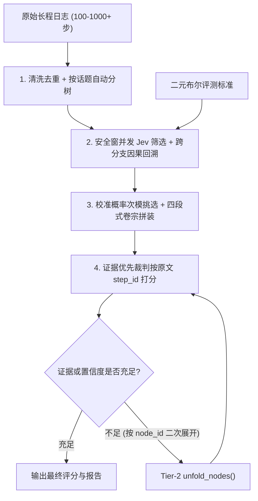

<div align="center">

<h1>trace-tree-eval</h1>

<p><strong>长程智能体轨迹的树形压缩与证据优先评测工具</strong></p>

<p>
  =3.10" />
  
  
  
</p>

<p>
  <strong>简体中文</strong> | <a href="README_EN.md">English</a>
</p>

<p>
  <a href="#-核心功能">核心功能</a> ·
  <a href="#-实测效果">实测效果</a> ·
  <a href="#-快速开始">快速开始</a> ·
  <a href="#-使用指南">使用指南</a> ·
  <a href="#-支持的数据格式与内置预设">格式与预设</a> ·
  <a href="#-技术细节与目录结构">工作原理</a>
</p>

</div>

---

**trace-tree-eval** 面向 100–1000+ 步长程智能体（Agent）执行日志的离线批量评测。针对“直接全量喂给大模型太贵且易看漏、简单截断会删掉关键错误、全文摘要易引入脑补”三大痛点，本工具将原始轨迹整理为一棵**可局部展开的执行树**：无关分支折叠为经过事实核验的短概览，决定对错的证据片段与跨步前因保留**完整原文与步骤号**，让大模型裁判以 1/5 到 1/20 的 Token 成本输出一致、可审计的评分结论。

---

## ✨ 核心功能

1. **🌳 树形分层压缩与原文保真**
   * 自动清洗网页样板、折叠连续相同报错循环，并按话题切换与子智能体（`agent_id`）边界生成执行树。
   * 折叠分支仅展示经 Jev 逐句核验的概览并标明 `[COLLAPSED]`；展开分支保留 100% 原始交互步骤与 `[step_id]`，杜绝摘要编造误导裁判。
   * 附带约 200 Token 的**全局执行清单**（工具调用次数、报错次数、是否做过自我核验），明确区分“智能体压根没做”与“被压缩删掉”。

2. **🎯 Jev 校准筛选与跨步因果补全**
   * 按 12K–20K 安全窗口切片并发调用非生成模型 **Jev**，避开超长上下文精度衰减区，单条扫描开销低至分毫级别。
   * 利用 Jev 校准概率按“边际收益递减”分配预算，防止单一高频报错占满篇幅导致其他评分项零证据漏判。
   * 自动从高分异常步往前检索并连出**跨分支因果边**（如“第 148 步推荐违背了第 18 步用户约束与第 112 步事实”），对高危维度保留独立扫描，并在证据不足时按节点自动二次展开（Tier-2 Unfold）。

3. **📊 批量对比评测与失败模式聚类**
   * 内置控制变量对比流水线，一键同台对比 `FullTrace`（全量）、`HeadTail`（首尾截断）、`LexicalRAG`（向量检索）与 `HybridTree`（本方法）。
   * 自动统计 Token 节省率、一致率、F1、假通过率（False-Pass Rate）、JS 散度与费用，并按评分项聚合**高频失败分布**。
   * 一键导出零外部 CDN 的单文件交互式 HTML 报告，在浏览器里直接折叠/展开树节点并查看引用步骤与因果连线。

4. **🛡️ 开箱即用与本地化缓存**
   * 核心仅依赖 `numpy`、`httpx`、`typer`、`rich`，内置零密钥离线 Mock 模式，不申请 API Key 也能先跑通全套演示与测试。
   * 自动加载 `.env` 配置文件（支持 OpenRouter 单 Key 接入或 TypeSafe 官方 Key），内置 `429`/`5xx`/超时指数退避重试与 SHA-256 本地磁盘缓存（`DiskCache`），重复调试预算参数不再重复扣费。

---

## 📊 实测效果

在内置的 **180 步跨分支矛盾仿真轨迹**上（含中途需求变更、28 步重复报错循环、子智能体调研、跨分支推荐冲突、漏交对比表与跳过自我核验，离线 Mock 模式实测），将上下文压缩至约 3,500 Tokens 的对比结果如下：

| 评测方法 | 输入 Token | Token 节省 | 与标准答案一致率 | 假通过率 (False-Pass) | 与全量分布差异 (JS 散度) |
| :--- | :---: | :---: | :---: | :---: | :---: |
| **FullTrace**（不压缩全量） | 19,493 | 0.0% | 100.0% | 0.0% | 0.0000 |
| **HeadTail**（首尾截断） | 3,951 | 79.7% | 33.3% | 66.7% | 0.2222 |
| **LexicalRAG**（向量相似检索） | 4,117 | 78.9% | 33.3% | 66.7% | 0.2222 |
| **HybridTree**（本项目方法） | **3,528** | **81.9%** | **100.0%** | **0.0%** | **0.0000** |

---

## ⚡ 快速开始

### 1. 环境准备与零依赖离线体验

无需安装额外大模型包或配置 API Key，克隆后直接运行：

**Windows (PowerShell)：**
```powershell
$env:PYTHONPATH = "src"

# 检查环境与脱敏配置
python -m trace_tree_eval doctor

# 运行 180 步仿真对比，并导出离线交互式 HTML 报告
python -m trace_tree_eval benchmark --dataset synthetic --budget 3500 --html-out outputs/demo_report.html

# 运行全套单元测试
python -m unittest discover -s tests -v
```

**macOS / Linux (bash)：**
```bash
PYTHONPATH=src python -m trace_tree_eval doctor
PYTHONPATH=src python -m trace_tree_eval benchmark --dataset synthetic --budget 3500 --html-out outputs/demo_report.html
PYTHONPATH=src python -m unittest discover -s tests -v
```

### 2. 接入真实模型（TypeSafe Jev / OpenRouter）

```bash
pip install -e ".[all]"
cp .env.example .env
```

编辑 `.env` 填入 API Key（只需一个 OpenRouter Key 即可同时调用 Jev 与裁判模型；程序启动会自动读取 `.env`）：

```ini
TYPESAFE_API_KEY=sk-or-v1-...
TYPESAFE_BASE_URL=https://openrouter.ai/api
JEV_MODEL=typesafe/jev-latest

OPENAI_API_KEY=sk-or-v1-...
OPENAI_BASE_URL=https://openrouter.ai/api/v1
OVERVIEW_MODEL=google/gemini-2.5-flash-lite
JUDGE_MODEL=anthropic/claude-sonnet-4
```

运行探活检查并评测公开长程数据集（建议加上 `--cache-dir` 避免重复调用计费）：

```bash
python -m trace_tree_eval doctor --ping
python -m trace_tree_eval benchmark "IPF/DeepResearch-traj" --dataset deep-research --min-steps 80 --limit 20 --cache-dir .tte_cache --live --html-out outputs/dr_report.html
```

### 3. Python 一行式调用

```python
from trace_tree_eval import load_traces, evaluate_trace, render_dossier_html

# 1. 自动识别 ATIF / Harbor / AgentRewardBench / DeepResearch-traj / JSONL
trajectories = load_traces("my_traces.jsonl", min_steps=30, limit=5)

# 2. 压缩并执行证据优先评判（live=True 即切换真实 .env 模型，cache_dir 开启本地缓存）
dossier, evaluation = evaluate_trace(
    trajectories[0],
    rubrics="preset:deep_research",
    budget_tokens=6000,
    live=False,
    cache_dir=".tte_cache",
)

# 3. 导出离线交互式 HTML 报告
with open("outputs/dossier.html", "w", encoding="utf-8") as f:
    f.write(render_dossier_html(dossier, evaluation))
```

---

## 📖 使用指南

1. **检查运行环境**：执行 `python -m trace_tree_eval doctor` 确认依赖与 `.env` 密钥状态（加 `--ping` 可真实发包测试）。
2. **选择评测标准**：使用 `python -m trace_tree_eval presets` 查看内置的“是/否”二元检查项预设，或自定义 JSON 文件传入 `--rubric`。
3. **压缩或批量对比**：
   * 单条/批量压缩轨迹为 Markdown 卷宗：`python -m trace_tree_eval compress trace.jsonl -r preset:deep_research -b 6000 -o dossier.md --html-out dossier.html`
   * 压缩并直接完成打分：`python -m trace_tree_eval evaluate trace.jsonl -r preset:deep_research --html-out eval.html`
   * 批量对比基线并聚类失败模式：`python -m trace_tree_eval benchmark SOURCE --dataset auto --limit 20 --html-out report.html`
4. **查看执行树与报告**：用浏览器直接打开生成的 `.html` 文件，或在终端运行 `python -m trace_tree_eval inspect dossier.json` 查看节点展开状态。

<details>
<summary>📋 点击展开：全部 CLI 命令与常用参数速查</summary>

| 命令 | 用途 | 常用参数 |
| :--- | :--- | :--- |
| `doctor` | 检查依赖与脱敏 `.env` 配置 | `--ping`（实测 API 连通性） |
| `presets` | 列出内置二元评测准绳预设 | — |
| `demo` | 运行内置 180 步单条对比演示 | `--budget`、`--live`、`--html-out`、`--cache-dir` |
| `compress` | 压缩单条或批量 JSONL 轨迹 | `-r/--rubric`、`-b/--budget`、`-o/--out`、`--json-out`、`--html-out`、`--trace-id`、`--cache-dir`、`--live` |
| `evaluate` | 压缩并运行证据优先裁判 | `-r/--rubric`、`-b/--budget`、`--trace-id`、`--json-out`、`--html-out`、`--cache-dir`、`--live` |
| `benchmark` | 批量对比基线与失败模式聚类 | `-d/--dataset`（`auto\|atif\|agent-reward-bench\|deep-research\|synthetic`）、`-r/--rubric`、`-b/--budget`、`--min-steps`、`-n/--limit`、`--no-baselines`、`--html-out`、`--json-out`、`--cache-dir`、`--live` |
| `inspect` | 终端树形查看折叠与展开结构 | 传入 `compress --json-out` 导出的 JSON 文件 |

</details>

---

## 🧩 支持的数据格式与内置预设

### 支持的轨迹来源

| 格式 / 数据集 | 适配器类 | 说明 |
| :--- | :--- | :--- |
| **ATIF / Harbor / HF Traces** | `ATIFAdapter` | 支持通用 `steps` / `messages` / `trajectory` JSON 与 JSONL，自动保留 `agent_id` |
| **AgentRewardBench** | `AgentRewardBenchAdapter` | 支持 `McGill-NLP/agent-reward-bench` 人工专家精标网页智能体轨迹 |
| **DeepResearch-traj / OpenResearcher** | `DeepResearchTrajAdapter` | 支持 `IPF/DeepResearch-traj` 等百步级深度网页调研长轨迹 |

### 内置布尔评测预设（`--rubric preset:<名称>`）

| 预设名 | 检查项数 | 重点覆盖维度（`*` 为高危维度） |
| :--- | :---: | :--- |
| `preset:deep_research` | 6 | `mid_task_constraint*`、`factual_grounding*`、`no_contradiction*`、`self_verification`、`deliverable_complete`、`loop_efficiency` |
| `preset:multi_turn_assistant` | 5 | `mid_task_constraint*`、`factual_grounding*`、`safety_compliance*`、`self_verification`、`deliverable_complete` |
| `preset:web_agent` | 5 | `goal_completion*`、`mid_task_constraint*`、`no_unauthorized_action*`、`self_verification`、`loop_efficiency` |
| `preset:coding_agent` | 5 | `mid_task_constraint*`、`self_verification*`、`factual_grounding*`、`deliverable_complete`、`loop_efficiency` |

---

## 🔧 技术细节与目录结构

<details>
<summary>🔍 点击展开：四阶段压缩工作原理（流程图）</summary>



</details>

<details>
<summary>📁 点击展开：项目目录结构</summary>

```text
trace-tree-eval/
├── LICENSE                    # MIT 开源协议
├── pyproject.toml             # 依赖声明与 CLI 入口配置
├── .env.example               # API 密钥配置模板
├── src/trace_tree_eval/
│   ├── __main__.py            # 支持 python -m trace_tree_eval 直接调用
│   ├── api.py                 # 一行式 Python API (load_traces, compress_trace, evaluate_trace)
│   ├── config.py              # 自动读取 .env 并做密钥脱敏显示
│   ├── presets.py             # 4 套内置客观布尔评测准绳预设
│   ├── report_html.py         # 零外部依赖交互式 HTML 报告生成器
│   ├── schema.py              # Trajectory, TreeNode, GlobalManifest, EvalDossier 等数据结构
│   ├── tokens.py              # 中英混合 Token 估算器（优先使用 tiktoken）
│   ├── adapters/              # ATIF / Harbor / AgentRewardBench / DeepResearch 数据适配器
│   ├── backends/              # Jev 与 OpenAI 兼容接口（含重试、DiskCache 缓存与 Mock）
│   ├── tree/                  # 清洗去重、语义分树、分支概览核验、跨分支前因回溯
│   ├── compression/           # 次模覆盖挑选、四段式卷宗渲染与 Tier-2 展开
│   ├── evaluation/            # 证据优先裁判、对比基线、散度/误判率指标与批量运行器
│   └── cli.py                 # Typer + Rich 命令行工具
├── examples/                  # 180 步仿真轨迹生成器、Rubric 示例与对比脚本
└── tests/                     # 单元测试（覆盖清洗、建树、挑选、回溯、缓存与 CLI）
```

</details>

<details>
<summary>⚙️ 点击展开：全部环境变量说明（.env）</summary>

| 变量名 | 默认值 | 说明 |
| :--- | :--- | :--- |
| `TYPESAFE_API_KEY` | — | TypeSafe 官方 Key 或 OpenRouter Key（`sk-or-v1-...`） |
| `TYPESAFE_BASE_URL` | `https://openrouter.ai/api` | Jev 网关地址（官方直连可设为 `https://api.typesafe.ai`） |
| `JEV_MODEL` | `typesafe/jev-latest` | Jev 决策模型标识 |
| `OPENAI_API_KEY` | — | OpenAI / OpenRouter API Key（未设时回退读取 `OPENROUTER_API_KEY`） |
| `OPENAI_BASE_URL` | `https://openrouter.ai/api/v1` | OpenAI 兼容文本模型接口地址 |
| `OVERVIEW_MODEL` | `google/gemini-2.5-flash-lite` | 用于生成折叠分支短概览的廉价小模型 |
| `JUDGE_MODEL` | `anthropic/claude-sonnet-4` | 下游证据优先评审大模型 |

</details>

---

## 📄 开源协议

本项目基于 [MIT License](LICENSE) 开源。
