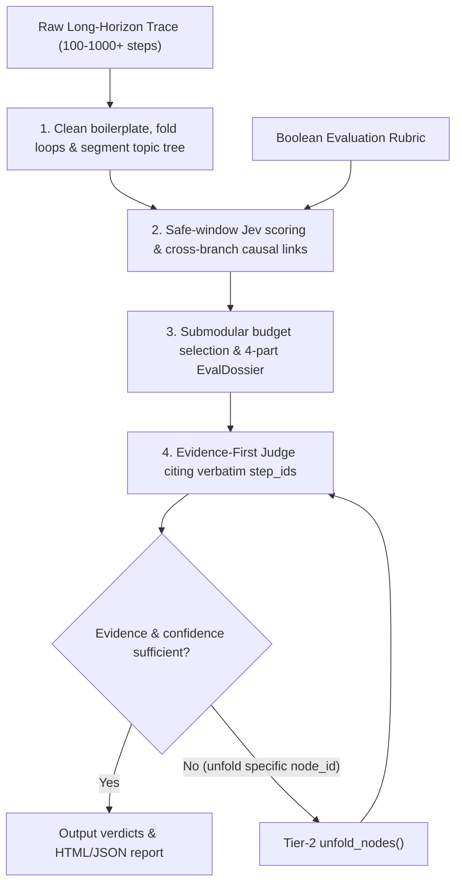

<div align="center">

<h1>trace-tree-eval</h1>

<p><strong>Tree-Based Trace Compaction &amp; Evidence-First Evaluation for Long-Horizon AI Agents</strong></p>

<p>
  =3.10" />
  
  
  
</p>

<p>
  <a href="README.md">简体中文</a> | <strong>English</strong>
</p>

<p>
  <a href="#-key-features">Key Features</a> ·
  <a href="#-benchmark-snapshot">Benchmark</a> ·
  <a href="#-quick-start">Quick Start</a> ·
  <a href="#-usage-guide">Usage Guide</a> ·
  <a href="#-supported-formats--presets">Formats &amp; Presets</a> ·
  <a href="#-architecture--directory-layout">Architecture</a>
</p>

</div>

---

**trace-tree-eval** makes batch evaluation of 100–1000+ step agent execution traces fast, affordable, and reliable. Instead of feeding raw logs of hundreds of thousands of tokens to an LLM judge (expensive and noisy), truncating head/tail (misses mid-trace failures), or rewriting the whole trace into a summary (risks compressor hallucinations), it turns a trace into a **partially expanded execution tree**: irrelevant branches fold into fact-checked overviews, while decisive steps and their causal antecedents stay **100% verbatim with `[step_id]` citations**.

---

## ✨ Key Features

1. **🌳 Hierarchical Tree Compaction with Zero-Hallucination Evidence**
   * Automatically strips repeated boilerplate, collapses retry loops, and segments long traces into a multi-level tree by topic shifts and `agent_id` boundaries.
   * Collapsed branches show short, Jev-verified overviews labeled `[COLLAPSED]`; expanded branches keep verbatim step text and exact `[step_id]` markers so the judge never relies on fabricated prose.
   * Includes a ~200-token **Global Execution Manifest** (tool call counts, error counts, self-verification detection) to distinguish "agent never ran step X" from "compressor dropped step X".

2. **🎯 Jev Calibrated Scoring & Cross-Branch Causal Retrieval**
   * Scans trace segments concurrently in 12K–20K safe windows using TypeSafe AI's non-generative **Jev** model, avoiding long-context accuracy decay at pennies per trace.
   * Allocates token budgets via monotone submodular maximization over Jev's calibrated probabilities so repeated errors never crowd out other rubric criteria.
   * Automatically traces **cross-branch causal links** backward (e.g., linking a flawed Step 148 recommendation back to a mid-task constraint at Step 18 and a fact read at Step 112), keeps selective scanning for `high_risk` criteria, and unfolds collapsed nodes on demand when confidence is low (Tier-2 escalation).

3. **📊 Batch Benchmarking & Failure-Mode Clustering**
   * Evaluates `HybridTree` side-by-side against `FullTrace`, `HeadTail`, and `LexicalRAG` under a strictly controlled judge harness.
   * Tracks token savings, ground-truth agreement, F1, False-Pass Rate, Jensen–Shannon divergence vs. full-trace verdicts, and API costs—plus clusters failures across rubric dimensions.
   * Exports self-contained, zero-CDN interactive HTML reports to inspect collapsible trees, risk tags, causal links, and cited steps offline.

4. **🛡️ Zero-Key Offline Mode & Local Disk Caching**
   * Core package requires only `numpy`, `httpx`, `typer`, and `rich`, with deterministic offline mocks to test and demo everything before adding API keys.
   * Automatically loads `.env` (supporting a single OpenRouter key or TypeSafe official endpoint), retries `429`/`5xx`/timeouts with exponential backoff, and caches API responses locally (`DiskCache`) so repeated budget sweeps cost `$0`.

---

## 📊 Benchmark Snapshot

Evaluated on the built-in **180-step unstructured Deep Research trace** (featuring a mid-task requirement update, a 28-step retry loop, a `sub_researcher` sub-agent branch, a cross-branch recommendation contradiction, omitted deliverables, and skipped self-verification; offline mock run) at a ~3,500-token target budget:

| Method | Input Tokens | Token Savings | Agreement vs. GT | False-Pass Rate | JS Div vs. Full |
| :--- | :---: | :---: | :---: | :---: | :---: |
| **FullTrace** (uncompressed) | 19,493 | 0.0% | 100.0% | 0.0% | 0.0000 |
| **HeadTail** (head/tail truncation) | 3,951 | 79.7% | 33.3% | 66.7% | 0.2222 |
| **LexicalRAG** (flat cosine top-k) | 4,117 | 78.9% | 33.3% | 66.7% | 0.2222 |
| **HybridTree** (Ours) | **3,528** | **81.9%** | **100.0%** | **0.0%** | **0.0000** |

---

## ⚡ Quick Start

### 1. Zero-Dependency Offline Run (No API Keys Needed)

**Windows (PowerShell):**
```powershell
$env:PYTHONPATH = "src"

# Check environment and masked configuration
python -m trace_tree_eval doctor

# Run the 180-step benchmark and export an interactive HTML report
python -m trace_tree_eval benchmark --dataset synthetic --budget 3500 --html-out outputs/demo_report.html

# Run the full test suite
python -m unittest discover -s tests -v
```

**macOS / Linux (bash):**
```bash
PYTHONPATH=src python -m trace_tree_eval doctor
PYTHONPATH=src python -m trace_tree_eval benchmark --dataset synthetic --budget 3500 --html-out outputs/demo_report.html
PYTHONPATH=src python -m unittest discover -s tests -v
```

### 2. Connect Live Models (TypeSafe Jev / OpenRouter)

```bash
pip install -e ".[all]"
cp .env.example .env
```

Fill in `.env` (a single OpenRouter key works for both Jev and the judge LLM; `.env` is loaded automatically on startup):

```ini
TYPESAFE_API_KEY=sk-or-v1-...
TYPESAFE_BASE_URL=https://openrouter.ai/api
JEV_MODEL=typesafe/jev-latest

OPENAI_API_KEY=sk-or-v1-...
OPENAI_BASE_URL=https://openrouter.ai/api/v1
OVERVIEW_MODEL=google/gemini-2.5-flash-lite
JUDGE_MODEL=anthropic/claude-sonnet-4
```

Verify connectivity and benchmark a public long-horizon dataset (use `--cache-dir` to cache responses locally):

```bash
python -m trace_tree_eval doctor --ping
python -m trace_tree_eval benchmark "IPF/DeepResearch-traj" --dataset deep-research --min-steps 80 --limit 20 --cache-dir .tte_cache --live --html-out outputs/dr_report.html
```

### 3. One-Line Python API

```python
from trace_tree_eval import load_traces, evaluate_trace, render_dossier_html

# 1. Load traces (auto-detects ATIF / Harbor / AgentRewardBench / DeepResearch-traj / JSONL)
trajectories = load_traces("my_traces.jsonl", min_steps=30, limit=5)

# 2. Compress & evaluate (set live=True to use .env models; cache_dir avoids duplicate API spend)
dossier, evaluation = evaluate_trace(
    trajectories[0],
    rubrics="preset:deep_research",
    budget_tokens=6000,
    live=False,
    cache_dir=".tte_cache",
)

# 3. Export a standalone interactive HTML viewer
with open("outputs/dossier.html", "w", encoding="utf-8") as f:
    f.write(render_dossier_html(dossier, evaluation))
```

---

## 📖 Usage Guide

1. **Check setup**: Run `python -m trace_tree_eval doctor` (add `--ping` to test live API connectivity).
2. **Pick a rubric**: Run `python -m trace_tree_eval presets` to view the built-in strict boolean presets, or pass your own rubric JSON via `--rubric`.
3. **Compress or benchmark**:
   * Compress a trace (or batch JSONL) to a dossier: `python -m trace_tree_eval compress trace.jsonl -r preset:deep_research -b 6000 -o dossier.md --html-out dossier.html`
   * Compress and score in one step: `python -m trace_tree_eval evaluate trace.jsonl -r preset:deep_research --html-out eval.html`
   * Run batch baseline comparisons & failure clustering: `python -m trace_tree_eval benchmark SOURCE --dataset auto --limit 20 --html-out report.html`
4. **Inspect results**: Open the generated `.html` file in any browser, or run `python -m trace_tree_eval inspect dossier.json` in your terminal.

<details>
<summary>📋 Expand: Full CLI Command & Option Reference</summary>

| Command | Description | Key Options |
| :--- | :--- | :--- |
| `doctor` | Check dependencies and masked `.env` config | `--ping` (probe live endpoints) |
| `presets` | List built-in boolean rubric presets | — |
| `demo` | Run the 180-step synthetic comparison demo | `--budget`, `--live`, `--html-out`, `--cache-dir` |
| `compress` | Compress one trace or a multi-trace JSONL | `-r/--rubric`, `-b/--budget`, `-o/--out`, `--json-out`, `--html-out`, `--trace-id`, `--cache-dir`, `--live` |
| `evaluate` | Compress and run Evidence-First Judge | `-r/--rubric`, `-b/--budget`, `--trace-id`, `--json-out`, `--html-out`, `--cache-dir`, `--live` |
| `benchmark` | Batch benchmark baselines & failure clusters | `-d/--dataset` (`auto\|atif\|agent-reward-bench\|deep-research\|synthetic`), `-r/--rubric`, `-b/--budget`, `--min-steps`, `-n/--limit`, `--no-baselines`, `--html-out`, `--json-out`, `--cache-dir`, `--live` |
| `inspect` | Print collapsed/expanded tree in terminal | Path to JSON exported by `compress --json-out` |

</details>

---

## 🧩 Supported Formats & Presets

### Trace & Dataset Adapters

| Format / Dataset | Adapter Class | Notes |
| :--- | :--- | :--- |
| **ATIF / Harbor / HF Traces** | `ATIFAdapter` | Parses `steps` / `messages` / `trajectory` JSON & JSONL while preserving `agent_id` |
| **AgentRewardBench** | `AgentRewardBenchAdapter` | Loads `McGill-NLP/agent-reward-bench` expert-annotated web agent trajectories |
| **DeepResearch-traj / OpenResearcher** | `DeepResearchTrajAdapter` | Loads `IPF/DeepResearch-traj` and 100+ turn deep-research rollouts |

### Built-in Boolean Presets (`--rubric preset:<name>`)

| Preset | Criteria | Dimensions (`*` = `high_risk`, always scanned) |
| :--- | :---: | :--- |
| `preset:deep_research` | 6 | `mid_task_constraint*`, `factual_grounding*`, `no_contradiction*`, `self_verification`, `deliverable_complete`, `loop_efficiency` |
| `preset:multi_turn_assistant` | 5 | `mid_task_constraint*`, `factual_grounding*`, `safety_compliance*`, `self_verification`, `deliverable_complete` |
| `preset:web_agent` | 5 | `goal_completion*`, `mid_task_constraint*`, `no_unauthorized_action*`, `self_verification`, `loop_efficiency` |
| `preset:coding_agent` | 5 | `mid_task_constraint*`, `self_verification*`, `factual_grounding*`, `deliverable_complete`, `loop_efficiency` |

---

## 🔧 Architecture & Directory Layout

<details>
<summary>🔍 Expand: Four-Stage Compaction Pipeline</summary>



</details>

<details>
<summary>📁 Expand: Project Directory Layout</summary>

```text
trace-tree-eval/
├── LICENSE                    # MIT License
├── pyproject.toml             # Package metadata, extras & CLI entry points
├── .env.example               # API configuration template
├── src/trace_tree_eval/
│   ├── __main__.py            # Enables `python -m trace_tree_eval`
│   ├── api.py                 # High-level API (load_traces, compress_trace, evaluate_trace)
│   ├── config.py              # Zero-dependency .env loader & masked env summary
│   ├── presets.py             # 4 built-in strict boolean rubric presets
│   ├── report_html.py         # Standalone interactive HTML report renderers
│   ├── schema.py              # Trajectory, TreeNode, GlobalManifest, EvalDossier dataclasses
│   ├── tokens.py              # Bilingual token estimator (uses tiktoken when installed)
│   ├── adapters/              # ATIF, Harbor, AgentRewardBench & DeepResearch adapters
│   ├── backends/              # Jev & OpenAI-compat backends (retries, DiskCache) + offline mocks
│   ├── tree/                  # Stage 0 cleaner, Stage 1 tree builder & Stage 2 causal edges
│   ├── compression/           # Stage 3 submodular solver, dossier renderer & HybridTreeCompressor
│   ├── evaluation/            # EvidenceFirstJudge, baselines, metrics & BatchEvaluator
│   └── cli.py                 # Typer + Rich CLI
├── examples/                  # 180-step synthetic trace generator, rubric & demo script
└── tests/                     # Unit tests covering cleaner, tree, submodular, cache & CLI
```

</details>

<details>
<summary>⚙️ Expand: Environment Variables (.env)</summary>

| Variable | Default | Purpose |
| :--- | :--- | :--- |
| `TYPESAFE_API_KEY` | — | TypeSafe official API key or OpenRouter key (`sk-or-v1-...`) |
| `TYPESAFE_BASE_URL` | `https://openrouter.ai/api` | Jev gateway URL (set `https://api.typesafe.ai` for direct official endpoint) |
| `JEV_MODEL` | `typesafe/jev-latest` | Jev decision model identifier |
| `OPENAI_API_KEY` | — | OpenAI / OpenRouter key (falls back to `OPENROUTER_API_KEY` if unset) |
| `OPENAI_BASE_URL` | `https://openrouter.ai/api/v1` | OpenAI-compatible text completion base URL |
| `OVERVIEW_MODEL` | `google/gemini-2.5-flash-lite` | Low-cost model used to draft branch overviews |
| `JUDGE_MODEL` | `anthropic/claude-sonnet-4` | Downstream Evidence-First Judge model |

</details>

---

## 📄 License

Released under the [MIT License](LICENSE).
